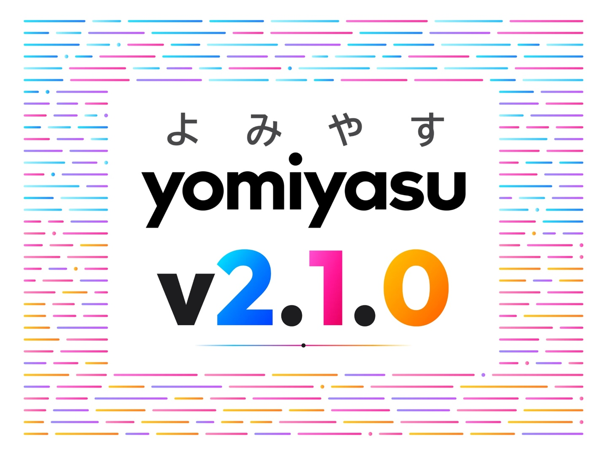

<p align="center">
  
</p>

# yomiyasu

[](./LICENSE)
[](https://github.com/nanaism/yomiyasu/releases)

[日本語](./README.md)

This page is a short English entry point. yomiyasu works on Japanese text only, and its instructions, check output and reports are in Japanese. The [Japanese README](./README.md) and the files in [docs/](./docs/) are the full documentation.

## What it does

yomiyasu (よみやす, "easy to read") is an agent skill that rewrites AI-generated Japanese prose to make it easier to read. It finds and rewrites unnatural metaphors, unclear subjects and predicates, tools and ideas written as if they had feelings or a will, filler phrases, and decoration such as heavy bold, bold labels with colons at the start of list items, emoji and trailing colons. It tries to leave parts that already read naturally as they are.

It tries to keep the meaning: numbers, negations, conditions, who does what, and how strongly a claim is made. Its instructions tell it not to add facts that are not in the original, the request or the material you provide, and to keep the original wording and ask the writer where the meaning cannot be decided from the text.

It is designed mainly for practical writing such as technical articles, design documents and specifications, pull request descriptions and internal reports. It also knows thirteen document types, including mail, minutes, slides, papers, essays or fiction and scripts, and is told not to change the usual style of each type.

Since 2.0.0, the instructions tell yomiyasu to run the bundled checks on its final draft before returning it. The diff check lists changes that may alter the meaning, such as changed numbers or negations and swapped subjects and objects, as items to review. The checks look for fixed patterns only and do not decide whether the meaning was kept.

The package is a set of instructions (SKILL.md) plus these checks.

If your environment cannot load the full skill, two versions built from it are published in separate repositories. Both are 2.0.0, built from 3.0.0. Use the full skill when your environment can load it.

- [yomiyasu-mini](https://github.com/nanaism/yomiyasu-mini) copies the full skill's SKILL.md section by section and packs the skill into 17 files, for hosts that limit the number or size of files, such as Microsoft 365 Copilot declarative agents. The full skill has many reference files, and its lint, diff and check scripts are each over 100KB. mini keeps each script at 90KB or less and each reference file at 100KB or less. It includes the meaning-change check, with the same results as the 3.0.0 diff.
- [yomiyasu-pocket](https://github.com/nanaism/yomiyasu-pocket) is a 400 to 500 character instruction to paste into an AI's instructions field, such as an email app's AI or a chat app's custom instructions. It has no bundled checks.

## Install

The install commands are the same as in the [Japanese README](./README.md#インストール), which also lists the update command for each method.

```bash
# skills CLI (recommended)
npx skills add nanaism/yomiyasu

# GitHub CLI
gh skill install nanaism/yomiyasu yomiyasu

# openskills (through AGENTS.md)
npx openskills install nanaism/yomiyasu
npx openskills sync
```

To install it as a Claude Code plugin, run these two commands in Claude Code.

```text
/plugin marketplace add nanaism/yomiyasu
/plugin install yomiyasu@yomiyasu
```

When installed as a Claude Code plugin, the skill is named `yomiyasu:yomiyasu`. Use that full name, as the slash completion shows it; a user reported that plain `yomiyasu` gave "Unknown skill".

For custom skills on Claude.ai (web), upload [yomiyasu.zip](https://github.com/nanaism/yomiyasu/releases/latest/download/yomiyasu.zip) from the latest release as it is, without unpacking it. The ZIP that GitHub's "Download ZIP" button makes contains the whole repository and may be rejected.

Codex reads skills from `.agents/skills/` in the repository you work in. If you do not use the methods above, or you open the repository in Codex Cloud, copy the `skills/yomiyasu/` folder into `.agents/skills/yomiyasu/`: paste the commands below as one block in the root folder of that repository. Run the same commands again to update.

```bash
(
  set -e
  tmp=$(mktemp -d)
  trap 'rm -rf "$tmp"' EXIT
  git clone --depth 1 https://github.com/nanaism/yomiyasu "$tmp/yomiyasu"
  mkdir -p .agents/skills
  if diff -r "$tmp/yomiyasu/skills/yomiyasu" .agents/skills/yomiyasu >/dev/null 2>&1; then
    echo "Already up to date: .agents/skills/yomiyasu"; exit 0
  fi
  if [ -e .agents/skills/yomiyasu ] || [ -L .agents/skills/yomiyasu ]; then
    backup=.agents/yomiyasu.bak-$(date +%Y%m%d-%H%M%S)
    if [ -e "$backup" ]; then echo "$backup already exists. Run this again in a second." >&2; exit 1; fi
    mv .agents/skills/yomiyasu "$backup"
    echo "Moved the previous folder to $backup"
  fi
  cp -R "$tmp/yomiyasu/skills/yomiyasu" .agents/skills/yomiyasu
  echo "Installed .agents/skills/yomiyasu"
)
```

The commands fetch the latest version into a temporary folder, copy it to `.agents/skills/yomiyasu/`, and then delete the temporary folder. If `.agents/skills/yomiyasu/` already exists and differs from the latest version, they move it to `.agents/yomiyasu.bak-DATE-TIME/` instead of deleting it. If its files are exactly the same as the latest version, nothing changes. If any file in it has changed or been added since you installed it (Finder's `.DS_Store`, for example), it is moved even when the version is the same. If the download fails, they stop and leave the existing folder as it is. The backup is placed outside `.agents/skills/`, where Codex looks for skills. Each update to a new version adds one more backup folder.

To go back to the previous folder, delete the new copy and move the backup back, using the name that was printed in place of `20261024-153000`.

```bash
rm -rf .agents/skills/yomiyasu
mv .agents/yomiyasu.bak-20261024-153000 .agents/skills/yomiyasu
```

Do not commit the backup folder, and delete it when you no longer need it.

Codex then lists the skill as `yomiyasu`. Call it by sending only `/yomiyasu` or by writing 「yomiyasu で」 ("with yomiyasu") in the request. Writing the listed name, `$yomiyasu`, also works. Up to 3.0.1 the copied skill was listed as `yomiyasu:yomiyasu`; after you install 3.1.0 or later, write `$yomiyasu` instead of `$yomiyasu:yomiyasu`, and change the name in your `AGENTS.md` line if you have one. The copied folder is not updated automatically; run the commands again to update.

Do not edit files inside the installed skill folder. Some install methods replace the whole folder on update, and your edits are not kept. Put project words in `.yomiyasu-words/` and your own instructions in `CLAUDE.md` or `AGENTS.md`, outside the skill folder.

## Usage

Name yomiyasu in the request and paste the draft. A request in Japanese looks like the example below.

```text
この文章を yomiyasu で読みやすくして。
（ここに修正したい文章を貼り付け）
```

The first line means "make this text easier to read with yomiyasu"; the second line is where your draft goes.

Sending only `/yomiyasu` makes the skill rewrite the text that the AI wrote in its previous answer, or the single draft (`.md` or `.txt`) directly under the working folder. When it works on a file, it does not overwrite the file and saves the final draft in the same folder under a new name.

You can tell it, in the request, the document type, how much the readers know, and who writes to whom (for example "取引先に送るメールです", an email to a client). With the relationship given, yomiyasu adjusts the politeness level the way a person in that relationship would write. If you say nothing, it infers the type from the text when it can and does not change the politeness.

When a number or condition is missing from the draft, the instructions tell yomiyasu to look for a sentence that states it in the original, the request, the material you gave, what you said in the conversation, files that were opened, or command output. It should fill the gap only when it finds such a sentence, without making it sound more certain, and otherwise leave the text as it is and ask the writer, but only where a reader could not act without the answer. The instructions say that its own earlier answers and general knowledge do not count as sources. This procedure has not yet been measured by running a model ([docs/limitations.md](./docs/limitations.md#確かめた範囲), in Japanese).

After the rewritten text, yomiyasu reports what it changed and the record of the checks it ran, and, when there is something to say, the AI-like wording it chose to keep and questions for the writer. Ask for "本文だけ" (the text only) to get the rewritten text alone; the checks still run.

Since 2.0.2, agents use yomiyasu only when you ask for it: when the request names yomiyasu, when you send `/yomiyasu`, or when you clearly ask for the Japanese proofreading skill. A request such as 「読みやすくして」 ("make it easier to read") without the name no longer selects it. If you want an agent to use yomiyasu every time it writes Japanese, add one line to your instruction file, such as `CLAUDE.md` for Claude Code or `AGENTS.md` for Codex. The section [毎回 yomiyasu を使いたいとき](./README.md#毎回-yomiyasu-を使いたいとき) ("to use yomiyasu every time") in the Japanese README has the line to paste for each host, with the skill name that each install method gives.

## Bundled tools

The skill comes with four Python scripts. They need only the Python standard library and are tested on Python 3.9 and 3.14. Their messages are in Japanese.

- `scripts/yomiyasu_lint.py` lists expressions and Markdown formatting worth reviewing in one document, line by line, such as metaphorical verbs, stock phrases, heavy bold or lists, emoji, and bold that will not render. Since 2.2.0 it also marks calques, metaphor-only headings, 「〜と言えるでしょう」, empty evaluations, vague katakana words, catchphrase commas and bare verb chains. Since 2.3.0 it also marks a transitive verb's bare stem used as a noun after 「の」 (「結果の確かめ」, 「二つの案の比べ」), which Japanese grammar research describes as hard to use; the skill rewrites it as a verb with its object or a settled Sino-Japanese noun. Since 2.4.0 it also marks a single kanji used as a noun for a short English term, such as 「版」 for "version", 「頭」 for "head" and 「印」 for "mark"; the skill writes the term people in the field use (「バージョン」, 「先頭」, 「指摘」) or asks the writer when it cannot tell what the word refers to. These marks are info only: the skill rereads the context and rewrites who does what, instead of swapping one word for another (writing the field's term for one of the single kanji above does not count as such a swap). Since 3.0.0 it also marks, as info, 「枝」 for "branch", 「題」 for "title" and 「罫」 for "border", and terms of two or more characters made for English terms (type 5), such as 「背景実行」 (background run), 「基準線」 (baseline) and 「根因」 (root cause), or 「見張り」 where the field term is 「監視」 (monitoring). 3.0.0 also widens the rule for 「前提」 (premise) with 「崩れる」 (collapse) to more verb forms; it stays a warn item, and its message now asks the agent to write out the premise when the nearby sentences state it, and otherwise to keep the text and ask the writer what no longer holds, and points to chapter 10 of `references/slop-catalog.md`. A project word list in `.yomiyasu-words/` (`allow.txt`, `flag.txt`) removes wrong marks and adds project-specific words. Since 3.0.0, a `flag.txt` word that mixes kanji and kana no longer matches inside a kanji compound (「根の」 does not match 「大根の」). To match inside words, or to match only a fixed form, write one `name<TAB>regex` per line in the new optional `flag-patterns.txt`; matching lines get a `project_term` mark. The regex syntax and limits are in [docs/tools.md](./docs/tools.md#プロジェクトの語の一覧) (in Japanese). With `--doc-type slides`, 2.4.0 also marks commas in headings and one-line bullets that only add a pause, such as after a sentence-initial 「だから」, a long time phrase or a short topic (`slide_comma`, info only); the skill removes those commas and keeps commas for contrast, conditions, reasons and lists.
- `scripts/yomiyasu_diff.py` compares the text before and after rewriting. It shows every change and puts changes that may alter the meaning first: numbers, negation, swapped subjects and objects, and sentence types such as hearsay, guesses and requests. Since 2.4.0 it also lists sentences where the rewrite added a person or role, as the subject or as the one to notify or ask, that is in neither the original nor the material given with `--material`.
- `scripts/yomiyasu_check.py` runs lint on the final draft and diff on the original and the final draft, and keeps a record in `.yomiyasu/` at the top of the git repository (or in the working folder outside git). `verify` checks right before submitting that the final draft is the one that was checked.
- `scripts/yomiyasu_hook.py` is an optional hook for Claude Code and Codex. It runs only if you add it to your own settings.

A `flag.txt` line can also be `word<TAB>replacement`, with an actual tab character. Only the left side is matched; `project_term` findings and the kept-word list in `check run` show the replacement. Lines without a tab, and lines indented with tabs, keep their existing behavior. A replacement can be up to 80 characters; a longer one, or a line with a third tab-separated column, stops lint, diff and check with exit code 2. A linked git worktree without `.yomiyasu-words/` reads the list from the original checkout. If the worktree has its own folder, only that folder is used.

On Windows, run them with `py -3` instead of `python3`, as in `py -3 scripts/yomiyasu_lint.py article.md`.

```bash
python3 scripts/yomiyasu_lint.py article.md
python3 scripts/yomiyasu_lint.py article.md --fail-on warn   # exit code 1 if there are warn or error items
python3 scripts/yomiyasu_diff.py original.md rewritten.md
python3 scripts/yomiyasu_check.py run --source original.md --final final.md
python3 scripts/yomiyasu_check.py verify --final final.md
```

The scripts only report items to review and the places that changed. They do not judge whether the meaning was kept or whether the text is easy to read. `lint --json` names its score key `rule_penalty_score` (`score` up to 1.1.2) and its "no findings" key `no_rule_findings` (`is_clean` up to 1.1.2); see [docs/tools.md](./docs/tools.md#json-を前のキーの名前で読んでいたとき) for jq examples.

## Limits

The checks catch fixed patterns only. Places without any item still need to be read against the original.

The rewriting was checked with Claude Code and Codex on macOS through their non-interactive commands (`claude -p` and `codex exec`). Rewriting has not been tested in the interactive interfaces, in installs through the Claude Code plugin, skills CLI, GitHub CLI or openskills, in Codex Cloud, in Cursor, with the Claude.ai ZIP upload, or on Windows. After the 2.0.2 release, installing from nanaism/yomiyasu on GitHub through the Claude Code plugin, skills CLI (`npx skills add`), GitHub CLI (`gh skill install`) and openskills (`npx openskills install`) was checked up to the point where Claude Code or Codex loads the skill (for openskills, up to reading it with `npx openskills read yomiyasu`). Readability and meaning changes with the 3.0.0 SKILL.md were measured only with Claude Code `claude -p` on macOS. On Codex, we only counted how many Sino-Japanese words were replaced with native Japanese words and how often native words were used. [docs/limitations.md](./docs/limitations.md) (Japanese) lists what the checks miss and what was measured.

## License

The code and documents in this repository are released under the [MIT License](./LICENSE). The copyright and permission notice for the bundled Unicode data is in [UNICODE-LICENSE.txt](./UNICODE-LICENSE.txt).

yomiyasu is a personal project by Aiichiro Oga ([@oga_aiichiro](https://x.com/oga_aiichiro)) at ALGO ARTIS. It is not an official product of the company and does not represent its views.
